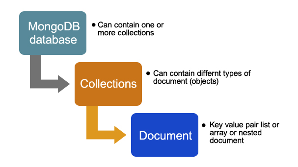
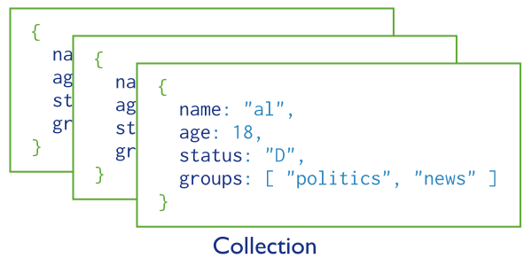
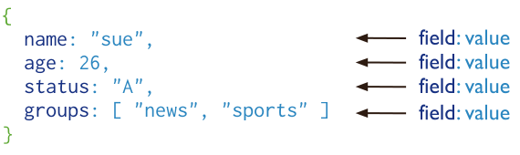
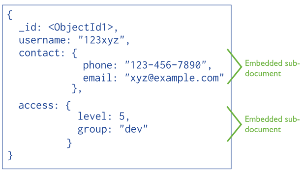
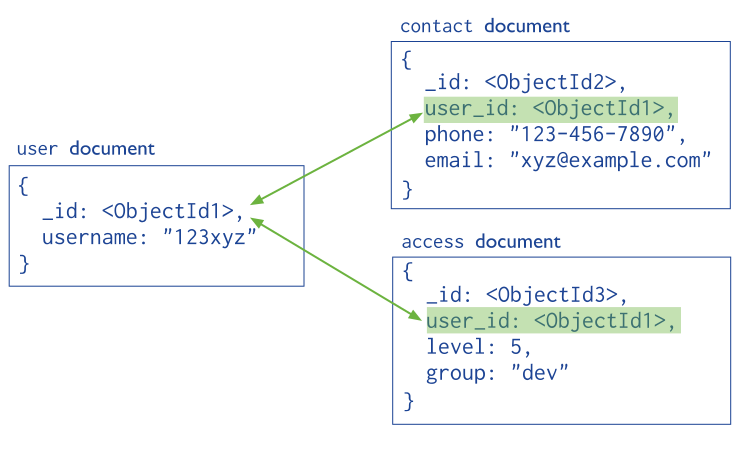

# **BOOTCAMP FULLSTACK**

## Fullstack FT Vitoria Octubre 2026
---

# BBDD NoSQL con MongoDB


- [Qué son las bases de datos NoSQL](https://aws.amazon.com/es/nosql/)
- [Documentación MongoDB](https://www.mongodb.com/es/docs/)
- [MongoDB](https://www.mongodb.com/es)
- [que-es-mongodb](https://openwebinars.net/blog/que-es-mongodb/)

# 1. ¿Qué es MongoDB?

MongoDb es un tipo de bases de datos no relacional `noSQL` orientada a documentos.


**NoSQL** significa "**Not Only SQL**" (No sólo SQL). Es un término general que se usa para referirse a **sistemas de bases de datos que no siguen el modelo relacional tradicional** (basado en tablas y SQL).

Estas bases de datos están diseñadas para manejar grandes cantidades de datos no estructurados o semi-estructurados, y ofrecen una mayor flexibilidad en cuanto a cómo se almacenan y acceden los datos.

Las BBDD de mongoDB se almacenan en un formato tipo BSON es un JSON pero mas efectivo.

**Diferencias entre json y bson**

- [json-and-bson](https://www.mongodb.com/json-and-bson)

1. JSON solo admite una cantidad limitada de tipos de datos básicos. En particular, JSON carece de soporte para fechas y datos binarios.

2. Los objetos y las propiedades JSON no tienen una longitud fija, lo que hace que el recorrido sea más lento. Está obligado a leer y analizar el documento secuencialmente (carácter a carácter) desde el inicio hasta encontrar el dato buscado, lo que ralentiza el recorrido.


### Características comunes de NoSQL:

1. **No requieren esquemas fijos**
   Puedes almacenar datos sin definir previamente una estructura estricta.

2. **Escalabilidad horizontal**
   Se pueden distribuir fácilmente entre múltiples servidores.

3. **Alto rendimiento para ciertas operaciones**
   Son muy rápidas para consultas específicas, especialmente en grandes volúmenes de datos.

4. **Diversos modelos de datos**
   Existen varios tipos de bases de datos NoSQL:

   * **Documentales** (como MongoDB)
   * **Clave-valor** (como Redis)
   * **Columnas anchas** (como Cassandra)
   * **Grafos** (como Neo4j)

#### ¿Por qué usar NoSQL?

* Cuando necesitas **alta escalabilidad y rendimiento**.
* Cuando trabajas con **datos que cambian de estructura** frecuentemente.
* Cuando manejas **grandes volúmenes de datos** como logs, redes sociales, IoT (Internet of Things), etc.


No existe una relación directa entre sus elementos a diferencia de las relacionales, no se agrupan por tablas, llaves primarias, foraneas ...

---

## 2. MongoDB vs SQL ¿Cuándo usar cada una?

### SQL vs NoSQL: Diferencias clave

#### SQL (Bases de datos relacionales)
- **Estructura**: Basadas en tablas con filas y columnas. Los datos se organizan en relaciones (tablas).
- **Esquema**: Esquema fijo y predefinido. Los datos deben ajustarse a una estructura rígida.
- **Consultas**: Utilizan SQL (Structured Query Language) para realizar consultas y operaciones.
- **Escalabilidad**: Escalabilidad vertical (aumentar recursos en un solo servidor).
- **Integridad**: Garantizan integridad referencial y transacciones ACID (Atomicidad, Consistencia, Aislamiento, Durabilidad).
- Aplicaciones con datos estructurados, como sistemas financieros, ERP, CRM, etc.

#### NoSQL (Bases de datos no relacionales)
- **Estructura**: Basadas en documentos, clave-valor, grafos o columnas. Los datos no tienen una estructura fija.
- **Esquema**: Esquema flexible o sin esquema. Permite almacenar datos no estructurados o semiestructurados.
- **Consultas**: Lenguajes específicos según el tipo de base de datos (por ejemplo, consultas JSON en MongoDB).
- **Escalabilidad**: Escalabilidad horizontal (añadir más servidores para manejar la carga).
- **Flexibilidad**: Diseñadas para manejar grandes volúmenes de datos y alta velocidad de escritura/lectura.
- Big Data, aplicaciones en tiempo real, redes sociales, IoT, etc.


**Diferencia breve entre escalabilidad horizontal y vertical**

- *Escalabilidad vertical*:
  Aumentar la **potencia de un solo servidor** (más CPU, RAM, disco).
  *Mejoras en el hardware del mismo equipo.*

* *Escalabilidad horizontal*:
  Agregar **más servidores** al sistema para repartir la carga.
  *Conectas varios equipos para trabajar juntos.*

**Transacciones ACID :**

Son un conjunto de propiedades que garantizan la fiabilidad y la integridad de las transacciones en bases de datos. Estas propiedades aseguran que las operaciones sean completas o no se realicen en absoluto, que se mantengan los estándares de datos, que cada transacción se ejecute sin interferencias y que los cambios se guarden permanentemente incluso si hay fallos. 

- **A - Atomicidad:** Una transacción se ejecuta como una sola unidad; o se completan todos sus pasos o ninguno se ejecuta. Si falla un paso, se revierte todo el proceso para evitar datos parciales.
- **C - Consistencia:** La transacción garantiza que la base de datos pase de un estado válido a otro estado válido, respetando todas las reglas y restricciones definidas (como que un campo de texto no puede contener números).
- **I - Aislamiento:** Cada transacción se ejecuta de forma independiente y aislada de las demás. Los resultados de una transacción no son visibles para otras hasta que se completa, evitando interferencias.
- **D - Durabilidad:** Una vez que una transacción se completa y se confirma (commit), sus cambios son permanentes y se almacenan de forma segura, incluso si el sistema sufre una falla (como un corte de energía).


#### Recursos adicionales

- [MongoDB | mongodb-mysql](https://www.mongodb.com/es/resources/compare/mongodb-mysql)
- [7-razones-mongodb](https://platzi.com/blog/7-razones-mongodb/)
- [mysql-vs-mongodb-cuando-y-donde-usar-cada-uno](https://impactotecno.wordpress.com/2018/02/26/mysql-vs-mongodb-cuando-y-donde-usar-cada-uno)
- [mongodb-como-funciona](https://siliconnews.plataformasinc.es/mongodb-como-funciona/)
---

## 3. MongoDB - Ejemplos de apps - casos de uso


**Aplicaciones de redes sociales**
- Almacenar perfiles de usuarios, publicaciones, comentarios, reacciones y mensajes.
- Su esquema flexible permite manejar datos no estructurados y cambiar la estructura de los documentos sin afectar la base de datos.

**Comercio electrónico**
- Gestión de catálogos de productos, carritos de compra, historial de pedidos y reseñas de clientes.
- **Razón para usar MongoDB**: La capacidad de manejar datos jerárquicos como productos con múltiples variantes y atributos.

**Aplicaciones de IoT (Internet de las cosas)**
- Almacenar datos de sensores, registros de eventos y análisis en tiempo real.
- **Razón para usar MongoDB**: Su capacidad para manejar grandes volúmenes de datos y realizar consultas rápidas.

**Sistemas de análisis de datos**
- Procesar y analizar grandes volúmenes de datos para obtener información útil.
- **Razón para usar MongoDB**: Su soporte para operaciones de agregación y consultas complejas.

**Aplicaciones de contenido multimedia**
- Almacenar metadatos de imágenes, videos y archivos de audio.
- **Razón para usar MongoDB**: Su capacidad para manejar datos no estructurados y consultas rápidas.

**Gestión de contenido (CMS)**
- Almacenar y gestionar contenido dinámico como blogs, páginas web y artículos.
- **Razón para usar MongoDB**: Su flexibilidad para manejar diferentes tipos de contenido y estructuras.

**Aplicaciones de geolocalización**
- Almacenar datos de ubicación, realizar búsquedas cercanas y análisis geoespacial.
- **Razón para usar MongoDB**: Su soporte para índices geoespaciales y consultas relacionadas.

**Aplicaciones financieras**
- Gestión de transacciones, análisis de riesgos y detección de fraudes.
- **Razón para usar MongoDB**: Su capacidad para manejar datos en tiempo real y realizar análisis complejos.

**Big Data y análisis en tiempo real**
- Procesar grandes volúmenes de datos generados por usuarios o sistemas.
- **Razón para usar MongoDB**: Su escalabilidad horizontal y soporte para particionamiento.

**Aplicaciones de mensajería y chat**
- Almacenar mensajes, historial de conversaciones y datos de usuarios.
- **Razón para usar MongoDB**: Su capacidad para manejar datos no estructurados y consultas rápidas.

#### Recursos adicionales
- [MongoDB | Casos de uso](https://www.mongodb.com/solutions/use-cases)
- [Real-world use cases of MongoDB](https://www.knowledgehut.com/blog/web-development/real-world-use-cases-of-mongodb)
- [MongoDB use case examples](https://hevodata.com/learn/mongodb-use-case/)

---

## 4. NoSQL con MongoDB - Estructura

**[Colecciones y documentos](https://www.mongodb.com/docs/manual/core/databases-and-collections/)**



**Colecciones**
  
**Documentos**
  
---

---
### Modelado de datos en MongoDB

#### Modelo de datos embebido

- [MongoDB | model-embedded-one-to-one-relationships-between-documents](https://docs.mongodb.com/manual/tutorial/model-embedded-one-to-one-relationships-between-documents/)

El modelo de datos embebido en MongoDB consiste en almacenar datos relacionados dentro de un mismo documento en lugar de dividirlos en múltiples colecciones. Este enfoque es útil cuando los datos relacionados se consultan juntos con frecuencia, ya que reduce la necesidad de realizar uniones o múltiples consultas.

##### Ventajas:
- **Rendimiento mejorado**: Las consultas son más rápidas porque los datos relacionados están en el mismo documento.
- **Simplicidad**: Menos necesidad de realizar uniones o referencias entre colecciones.
- **Atomicidad**: Las operaciones de escritura en un solo documento son atómicas.

##### Desventajas:
- **Tamaño del documento**: Los documentos tienen un límite de 16 MB, lo que puede ser un problema si los datos embebidos son muy grandes.
- **Redundancia**: Puede haber duplicación de datos si los mismos datos embebidos se repiten en múltiples documentos.

##### Ejemplo:
Supongamos que tenemos una base de datos para gestionar pedidos de una tienda en línea. Un modelo embebido podría verse así:

```json
{
    "_id": 1,
    "cliente": {
        "nombre": "Juan Pérez",
        "email": "juan.perez@example.com"
    },
    "productos": [
        {
            "nombre": "Laptop",
            "cantidad": 1,
            "precio": 1200
        },
        {
            "nombre": "Mouse",
            "cantidad": 2,
            "precio": 25
        }
    ],
    "fecha": "2023-10-01",
    "total": 1250
}
```

En este ejemplo, los datos del cliente y los productos están embebidos dentro del documento del pedido.

##### Casos de uso:
- Datos que tienen una relación uno a pocos o pocos a pocos.
- Datos que se consultan juntos con frecuencia.
- Escenarios donde los datos relacionados no cambian con frecuencia.

##### Más información:

- [MongoDB | Data Modeling](https://www.mongodb.com/docs/manual/core/data-model-design/)
- [MongoDB | Embedded Data Models](https://www.mongodb.com/es/docs/manual/data-modeling/embedding/)


#### Modelo de datos normalizado
  
- [MongoDB | database-references](https://docs.mongodb.com/manual/reference/database-references/)

El modelo de datos normalizado en MongoDB implica dividir los datos relacionados en múltiples colecciones y establecer referencias entre ellas. Este enfoque es útil cuando los datos relacionados cambian con frecuencia o cuando se necesita evitar la duplicación de datos.

##### Ventajas:
- **Reducción de redundancia**: Minimiza la duplicación de datos, lo que ahorra espacio de almacenamiento.
- **Mantenimiento más sencillo**: Los cambios en los datos relacionados solo necesitan realizarse en un lugar.
- **Escalabilidad**: Facilita la gestión de datos complejos y relaciones entre ellos.

##### Desventajas:
- **Consultas más complejas**: Requiere realizar múltiples consultas o uniones para obtener datos relacionados.
- **Rendimiento**: Las consultas pueden ser más lentas debido a la necesidad de combinar datos de varias colecciones.


##### Ejemplo:
Supongamos que tenemos una base de datos para gestionar pedidos de una tienda en línea. Un modelo normalizado podría verse así:

**Colección de clientes:**
```json
{
    "_id": 1,
    "nombre": "Juan Pérez",
    "email": "juan.perez@example.com"
}
```

**Colección de pedidos:**
```json
{
    "_id": 101,
    "cliente_id": 1,
    "fecha": "2023-10-01",
    "total": 1250
}
```

**Colección de productos:**
```json
{
    "_id": 201,
    "pedido_id": 101,
    "nombre": "Laptop",
    "cantidad": 1,
    "precio": 1200
},
{
    "_id": 202,
    "pedido_id": 101,
    "nombre": "Mouse",
    "cantidad": 2,
    "precio": 25
}
```

En este ejemplo, los datos del cliente, los pedidos y los productos están separados en diferentes colecciones, y las relaciones se establecen mediante identificadores.

##### Casos de uso:
- Datos que tienen relaciones uno a muchos o muchos a muchos.
- Escenarios donde los datos relacionados cambian con frecuencia.
- Aplicaciones que requieren evitar la duplicación de datos.

##### Más información:
- [MongoDB | data-model-design](https://docs.mongodb.com/manual/core/data-model-design/)

- [MongoDB | Model Referenced Relationships](https://www.mongodb.com/docs/manual/tutorial/model-referenced-one-to-many-relationships-between-documents/)
- [MongoDB - Relationships | Tutorialspoint](https://www.tutorialspoint.com/mongodb/mongodb_relationships.htm)


---


## 5. Conexión local con MongoDB Compass

#### 1. ¿Cómo se relacionan las herramientas de MongoDB?

Para trabajar con MongoDB es fundamental distinguir entre el motor que guarda los datos y la interfaz que usamos para verlos:

* **MongoDB (Community Server):** Es el **motor de base de datos** (el servidor). Se ejecuta en segundo plano en nuestro ordenador, gestiona los archivos y escucha peticiones de lectura o escritura.
* **MongoDB Compass:** Es el **cliente gráfico oficial (GUI)**. Es una aplicación de escritorio que se conecta al servidor de MongoDB para permitirnos explorar bases de datos, crear colecciones y lanzar consultas de forma visual, sin depender exclusivamente de la terminal.
* **MongoDB Atlas:** Es el servicio oficial de **MongoDB en la nube** (*Cloud*). 

**¿Cómo se conectan?** Ambos programas se comunican mediante una **URI de conexión** a través de red. Por defecto, el servidor local de MongoDB escucha en el puerto **`27017`**, por lo que Compass apunta a esa dirección para establecer el enlace.


#### 2. Conectar MongoDB Compass a una base de datos local

1. **Comprobar el servicio:** Asegúrate de que el servidor local de **MongoDB** está iniciado.
2. **Abrir MongoDB Compass:** Inicia la aplicación de escritorio y pulsa en **New Connection** (Nueva conexión).
3. **Introducir la URI local:** Escribe la cadena de conexión por defecto para un servidor instalado en tu propio equipo y pulsa **Connect**:
```shell
  mongodb://localhost:27017
```
---
## 6. Crear un clúster gratuito en MongoDB Atlas y conectarlo a Compass

#### 1. ¿Qué es MongoDB Atlas?

**MongoDB Atlas** es el servicio oficial de base de datos en la nube (*Database as a Service*). A diferencia de la instalación local (`localhost`), donde el servidor corre en tu propio ordenador, Atlas aloja y gestiona el servidor en proveedores como **AWS, Google Cloud o Microsoft Azure**, permitiéndote acceder a tus datos desde cualquier lugar a través de Internet.


#### 2. Desplegar un clúster gratuito (Plan M0)

1. **Crear cuenta:** Accede a [MongoDB Atlas](https://www.mongodb.com/cloud/atlas) y regístrate de forma gratuita.
2. **Crear el clúster:** Dentro de tu proyecto (*Project Overview* o *Clusters*), pulsa el botón **Create**.
3. **Seleccionar el nivel gratuito:** Elige la opción **M0** (*Free*), que es gratuita de forma indefinida y está pensada para aprendizaje y pequeños proyectos.
4. **Configurar ubicación y nombre:** Selecciona el proveedor en la nube (por ejemplo, AWS), elige la región más cercana disponible para el nivel gratuito, ponle un nombre al clúster (por ejemplo, `Cluster0`) y pulsa **Create Deployment**.


#### 3. Configurar los permisos de seguridad

Por seguridad, Atlas bloquea cualquier acceso externo por defecto. Antes de conectar Compass, debes configurar dos elementos:

1. **Usuario de base de datos (*Database Access*):** Crea un nombre de usuario y una contraseña específicos para acceder a los datos (son independientes del correo y contraseña con los que entras a la web de Atlas). Guarda ambas credenciales.
2. **Autorización de red (*Network Access*):** Añade tu dirección IP pulsando **Add My Current IP Address** para permitir conexiones desde tu equipo. *(Nota para clase: si los alumnos trabajan desde redes con IP dinámica o distintos lugares, pueden autorizar `0.0.0.0/0` únicamente durante las prácticas).*


#### 4. Conectar MongoDB Compass mediante la URI en la nube

1. En el panel de **Clusters** de Atlas, pulsa el botón **Connect** junto a tu clúster y selecciona **Compass** (*I have MongoDB Compass*).
2. Copia la cadena de conexión (**URI**) que te proporciona Atlas. A diferencia de la URI local (`mongodb://localhost:27017`), en la nube utiliza el protocolo **`mongodb+srv://`**:
```text
mongodb+srv://<usuario>:<contraseña>@cluster0.xxxxx.mongodb.net/

```


3. Abre **MongoDB Compass** en tu ordenador, pulsa **New Connection** y pega la URI en el cuadro de texto.
4. **Sustituye los marcadores de usuario y contraseña** (sin incluir los corchetes angulares) por las credenciales de base de datos que creaste en el punto anterior.
5. Pulsa **Save & Connect** (puedes guardarla en *Favorites* con un nombre y color distintos a los de tu servidor local para diferenciarlos fácilmente).


---
## 7. Comandos básicos mongo shell

**Mostrar todas las bases de datos**

```mongoDb
    show dbs
```

**Entrar en una base de datos concreta o crear una nueva base de datos**

```mongoDb
    use <nombreBaseDatos>
    ej: use shop
```


Si hacemos "show dbs" aún no muestra nada, esto es porque con este comando sólo muestra las bases de datos donde hay al menos una colección

**Ver las collecciones de una base de datos**

```mongoDb
    //seleccionamos la base de datos
        use shop

    //ver las colecciones
        show collections
```

**Acceder a los datos de una collección**

```mongoDb
    db.<nombreColeccion>.find()
    ej: db.clientes.find()
```
---
## 8. CRUD (create, read, update y delete)

### 1. CREATE

**Añadir un documento a la collección**

```javascript
    db.clientes.insertOne(
      {
        nombre: "Laura Pérez",
        email: "laura.perez@example.com",
        telefono: ["+34 600123456", "+34 699987654"],
        direcciones: [
          {
            tipo: "casa",
            calle: "Calle Mayor 123",
            ciudad: "Madrid",
            pais: "España"
          },
          {
            tipo: "trabajo",
            calle: "Av. de América 45",
            ciudad: "Madrid",
            pais: "España"
          }
        ],
        compras: [
          { producto: "Laptop", precio: 1200, fecha: "2024-03-15" },
          { producto: "Ratón", precio: 25, fecha: "2024-04-22" }
        ]
      }
    )
```


**Añadir varios documentos a la collección**


```javascript
  db.clientes.insertMany([
    {
      nombre: "Laura Gómez",
      email: "laura.gomez@example.com",
      telefono: ["+34 600123456", "+34 699987654"],
      direcciones: [
        {
          tipo: "casa",
          calle: "Calle Mayor 123",
          ciudad: "Madrid",
          pais: "España"
        },
        {
          tipo: "trabajo",
          calle: "Av. de América 45",
          ciudad: "Madrid",
          pais: "España"
        }
      ],
      compras: [
        { producto: "Laptop", precio: 1200, fecha: "2024-03-15" },
        { producto: "Ratón", precio: 25, fecha: "2024-04-22" }
      ]
    },
    {
      nombre: "Carlos Ruiz",
      email: "carlos.ruiz@example.com",
      telefono: ["+34 611234567"],
      direcciones: [
        {
          tipo: "casa",
          calle: "Calle de Alcalá 58",
          ciudad: "Madrid",
          pais: "España"
        }
      ],
      compras: []
    },
    {
      nombre: "María López",
      email: "maria.lopez@example.com",
      telefono: ["+34 612345678"],
      direcciones: [
        {
          tipo: "casa",
          calle: "Calle Princesa 10",
          ciudad: "Barcelona",
          pais: "España"
        }
      ],
      compras: [
        { producto: "Tablet", precio: 350, fecha: "2023-11-10" }
      ]
    },
    {
    nombre: "José Martínez",
      email: "jose.martinez@example.com",
      telefono: ["+34 613456789"],
      direcciones: [],
      compras: [
        { producto: "Monitor", precio: 200, fecha: "2024-05-01" },
        { producto: "Teclado", precio: 50, fecha: "2024-05-02" }
      ]
    },
    {
      nombre: "Ana Torres",
      email: "ana.torres@example.com",
      telefono: [],
      direcciones: [
        {
          tipo: "casa",
          calle: "Rambla Catalunya 33",
          ciudad: "Barcelona",
          pais: "España"
        }
      ],
      compras: []
    },
    {
      nombre: "David Fernández",
      email: "david.fernandez@example.com",
      telefono: ["+34 614567890"],
      direcciones: [
        {
          tipo: "trabajo",
          calle: "Paseo de Gracia 22",
          ciudad: "Barcelona",
          pais: "España"
        }
      ],
      compras: [
        { producto: "Auriculares", precio: 80, fecha: "2024-02-14" }
      ]
    },
    {
    nombre: "Lucía Navarro",
      email: "lucia.navarro@example.com",
      telefono: ["+34 615678901"],
      direcciones: [],
      compras: [
        { producto: "Smartphone", precio: 900, fecha: "2023-12-20" },
        { producto: "Cargador", precio: 30, fecha: "2024-01-05" }
      ]
    },
    {
      nombre: "Miguel Álvarez",
      email: "miguel.alvarez@example.com",
      telefono: [],
      direcciones: [],
      compras: []
    },
    {
      nombre: "Isabel Romero",
      email: "isabel.romero@example.com",
      telefono: ["+34 616789012"],
      direcciones: [
        {
          tipo: "casa",
          calle: "Gran Vía 80",
          ciudad: "Valencia",
          pais: "España"
        }
      ],
      compras: [
        { producto: "Impresora", precio: 150, fecha: "2024-06-01" }
      ]
    },
    {

      nombre: "Raúl Díaz",
      email: "raul.diaz@example.com",
      telefono: ["+34 617890123"],
      direcciones: [
        {
          tipo: "trabajo",
          calle: "Av. Constitución 100",
          ciudad: "Sevilla",
          pais: "España"
        }
      ],
      compras: []
    }
  ])

```


### 2. READ

**Leer todos los documentos**

```mongoDB
db.clientes.find()
```

**Leer x cantidad de elementos**

```mongoDB
db.clientes.find().limit(2)
```

**Leer accediendo por filtro**

```mongoDB
db.clientes.find({ nombre: "Laura Gómez" })
db.clientes.find({ "direcciones.ciudad": "Barcelona" })
```

**Comparadores**

  - **gt:** greater than  `>`
  - **gte:** greater than equal `>=`
  - **lt:** lower than  `>` 
  - **lte:** -> lower than equal `>=`

```mongoDB

db.clientes.find({"compras.precio": {$gte:350}})
db.clientes.find({"compras.fecha": { $gte: ISODate("2022-01-12") }})

```

**PROYECCIONES**
Las proyecciones en MongoDB se utilizan para seleccionar qué campos quieres incluir o excluir al consultar documentos en una colección.

```mongoDB
db.<nombreColeccion>.find(<query>,<projeccion>)
//8. Mostrar solo nombre y email (sin _id)
db.clientes.find({}, { nombre: 1, email: 1, _id: 0 })

db.clientes.find({"direcciones.pais":"España"}, {"nombre":1,"direcciones.ciudad":1})
db.clientes.find({"direcciones.pais":"España"}, {"nombre":1,"direcciones.ciudad":1}).limit(2)


//si no queremos mostrar el id
db.clientes.find({"direcciones.pais":"España"}, {"nombre":1,"direcciones.ciudad":1,_id:0})

//si queremos que muestre todo menos algo
db.clientes.find({"direcciones.pais":"España"}, {"nombre":0,"direcciones.ciudad":0,_id:0})

//Mostrar todos los registros pero sin X campos
db.clientes.find({}, {"nombre":0,"direcciones":0,_id:0})

```

**si existe o no existe**

```mongoDB
db.clientes.find({compras:{$exists:true}})
db.clientes.find({compras:{$exists:false}})

// Clientes que tengan más de un número de teléfono
db.clientes.find({ "telefono.1": { $exists: true } })
```

**Leer una propiedad de un objeto**

```mongoDB
db.clientes.find({ "compras.producto": "Laptop" })

// Clientes con al menos una compra de más de 500€
db.clientes.find({ "compras.precio": { $gt: 500 } })

```

**Leer de un array**

```mongoDB
db.clientes.find( { "compras.producto": { $in: ["Laptop" ]} } )
// Clientes que no han hecho ninguna compra
db.clientes.find({ compras: { $eq: [] } })
```

**OR**

```mongoDB

 db.clientes.find({$or:[ {estado:false}, {antiguedad:3}] })
```

**OR y AND**

```mongoDB
db.clientes.find({ ciudad: "granada" ,  $or:[ {estado:false}, {antiguedad:3}]  })
```

**Ordenar**

```mongoDB
// Clientes ordenados por nombre (ascendente)
db.clientes.find().sort({ nombre: 1 })

// Clientes ordenados por nombre (descendente)
db.clientes.find().sort({ nombre: -1 })
```

### 3. UPDATE

**Actualizar un documento**

```mongoDB
db.<nombreColeccion>.updateOne({_id;ObjectId("xxxxxxxxxx")},{$set: {llave:valor}})

//Actualizar el email de un cliente específico
db.clientes.updateOne(
  { nombre: "Laura Gómez" },
  { $set: { email: "laura.nueva@example.com" } }
)
//Agregar un nuevo número de teléfono
db.clientes.updateOne(
  { nombre: "Carlos Ruiz" },
  { $push: { telefono: "+34 611000000" } }
)


// Agregar una nueva compra (append al array)
db.clientes.updateOne(
  { nombre: "María López" },
  {
    $push: {
      compras: {
        producto: "Funda Tablet",
        precio: 20,
        fecha: "2025-06-02"
      }
    }
  }
)

```

**Actualizar varios registros**

```mongoDB
db.<nombreColeccion>.updateMany({filtro},{$set: {llave:valor}},{opciones})
// Agregar un nuevo campo a todos los clientes
db.clientes.updateMany(
  {},
  { $set: { activo: true } }
)
// Actualizar a todos los clientes de Barcelona
db.clientes.updateMany(
  { "direcciones.ciudad": "Barcelona" },
  { $set: { ciudadPrincipal: "Barcelona" } }
)

//Agregar un número de teléfono común a todos los clientes sin teléfono
db.clientes.updateMany(
  { telefono: { $eq: [] } },
  { $push: { telefono: "+34 600000000" } }
)
//Aumentar el precio de todos los productos comprados en un 10%
db.clientes.updateMany(
  {},
  { $mul: { "compras.$[].precio": 1.1 } }
)
// $[] = operador posicional "todos los elementos":
// multiplica el campo 'precio' de CADA objeto dentro
// del array 'compras' por 1.1 (aumenta un 10%)

// Si añadimos un campo que no existe lo creara
db.clientes.updateMany(
  {antiguedad: {$gte:4}},
  {$set: {mas_de:1}}
)


//actualizar e insertar un array
db.clientes.updateMany(
  {},
  {$set: {"compras":["compra1","compra2"]}}
)

```

**Otros operadoresde actualización además del $set (modificadores de campo)**
    - [Operadores de actualización](https://www.mongodb.com/docs/manual/reference/operator/update-field/)

```mongoDB
//AÑADIMOS PARA EL EJEMPLO
db.clientes.updateMany({ },{$set: {descuento:true}})

//Esta consulta elimina el campo requiereContacto en todos los clientes que sí tienen al menos un número de teléfono registrado.
db.clientes.updateMany(
  { telefono: { $exists: true, $ne: [] } },
  { $unset: { requiereContacto: true } }
)

//Supongamos que accidentalmente en algunos documentos de clientes se agregó un campo notaAdicional: "" (una cadena vacía), y queremos eliminar ese campo si está vacío.
db.clientes.updateMany(
  { notaAdicional: "" },
  { $unset: { notaAdicional: "" } }
)
```

**Otros operadores para actualizar arrays**

```mongoDB
//añadir un alemento al array sólo si no existe $addToSet
db.clientes.updateMany(
  {_id: ObjectId("6339c38fb48767c8a9e311b7")},
  {$addToSet:{"articulos":'nuevo articulo'}}
)

//añadir un alemento al array aunque exista $push
db.clientes.updateMany(
  {_id: ObjectId("6339c38fb48767c8a9e311b7")},
  {$push:{"articulos":'nuevo articulo'}}
)

//Elimina el último (1) o el primer (-1) elemento del array $pop
db.clientes.updateMany(
  {_id: ObjectId("6339c38fb48767c8a9e311b7")},
  {$pop:{"articulos":1}}
)
db.clientes.updateMany(
  {_id: ObjectId("6339c38fb48767c8a9e311b7")},{$pop:{"articulos":-1}}
)

//Eliminar todos los elementos que coincidan con la consulta $pull
db.clientes.updateMany(
  {_id: ObjectId("6339c38fb48767c8a9e311b7")},
  {$pull:{"articulos":"compra3"}}
  )

//Eliminar todos los elementos que coincidan con varias consultas $pullAll
db.clientes.updateMany(
  {_id: ObjectId("6339c38fb48767c8a9e311b7")},
  {$pullAll:{"articulos":["nuevo articulo", "nueva compra2"]}}
)
```

**Modificadores de arrays**

```mongoDB
//$each -> permite añadir varios elementos
db.clientes.updateMany(
  { _id: ObjectId("6339c38fb48767c8a9e311b7") },
  {
    $push: {
      articulos: {
        $each: [
          { rating: 2, comentario: "este es el comentario" },
          { rating: 5, comentario: "este es el comentario de 5" }
        ]
      }
    }
  }
)

```

**UPSERTS** 
{upsert: true} -> Si el documento existe, se actualiza, Si no existe, crea un nuevo documento.
{upsert: false} -> Si lo encuentra, actualiza el campo, si no encuentra no hace nada (no crea ningún documento nuevo).

```mongoDB
db.collection.updateOne( <filter>,<update>,{ upsert: <boolean>} )

db.clientes.updateOne(
  {_id:ObjectId("63397eccb48767c8a9e312ac")},
  {$set:{ciudad:"malaga"}},{upsert:true}
)
```

## 4. DELETE

**Reemplazar**
replaceOne - obliga a cambiar todo el documento, No se pueden utilizar operadores de actualización

```mongoDB
db.clientes.replaceOne(
  {_id: ObjectId("6339c38fb48767c8a9e311b7")},
  {"nombre":"Ana", "apellidos":"martin"}
)
db.clientes.replaceOne(
  {"nombre":"Lola"},
  {"nombre":"Lolita", "apellidos":"martin"},{upsert:true}
)
```

**Eliminar**

1. deleteOne

```mongoDB
db.clientes.deleteOne({_id: ObjectId("6339c38fb48767c8a9e311b7")})
```

2. deleteMany

```mongoDB
db.clientes.deleteMany({antiguedad: 6})
db.clientes.deleteMany({nombre: "Lolita"})
```

--- 
## Prácticas BBDD Restaurante


### Ejercicio 1
**Importación de datos en MongoDB**

[Datos ejercicio](./utils/ejercicioMongoDB/restaurants.json)
En MongoCompass, creamos una colección. En dicha colección aparece el botón add data. Al pulsar en el botón aparecerá la opción  `Import JSON or CSV files`,  seleccionar el archivo JSON que queremos importar en nuestra colección.

**Ejercicios**

1. Mostrar todos los documentos de la colección restaurantes
2. Mostrar los campos restaurant_id, nombre, distrito y cocina, pero excluya el campo _id para todos los documentos de la colección restaurantes
3. Mostrar los primeros 5 restaurantes que se encuentran en el distrito Bronx
4. Devolver los restaurantes que se ubican en un valor de latitud inferior a -95.754168
5. Devolver los restaurantes que no preparan cocina americana y lograron una puntuación superior a 70 y se ubicaron en una longitud inferior a -65.754168. Nota: Realice esta consulta sin usar el operador $and
6. Devolver los restaurantes que no preparan cocina americana y lograron un punto de calificación 'A' que no pertenece al distrito de Brooklyn. El documento debe mostrarse según la cocina en orden descendente.
7. Devolver los restaurantes que pertenecen al distrito Bronx y preparan platos americanos o chinos
8. Devolver ID del restaurante, nombre, distrito y la cocina para aquellos restaurantes que pertenecen al distrito de Staten Island o Queens o Bronx o Brooklyn
9. Devolver ID del restaurante, nombre, distrito y la cocina de aquellos restaurantes que lograron una puntuación que no supere los 10
10. Devolver ID del restaurante, el nombre y las calificaciones del restaurante para aquellos restaurantes que obtuvieron una calificación de "A" y obtuvieron un puntaje de 11 en una fecha ISO "2014-08-11T00: 00: 00Z" entre muchas fechas de encuesta
11. Devolver ID del restaurante, nombre, dirección y ubicación geográfica del restaurante de aquellos donde el segundo elemento de la matriz coord contiene un valor que es más de 42 y hasta 52
12. Actualiza los restaurantes. Cambia el tipo de cocina 'Ice Cream, Gelato, Yogurt, Ices' por 'sweets'
13. Actualiza nombre del restaurante 'Wild Asia' por 'Wild Wild West'
14. Borra los restaurantes con latitud menor que -95.754168
15. Borra los restaurantes cuyo nombre empiece por 'C'

